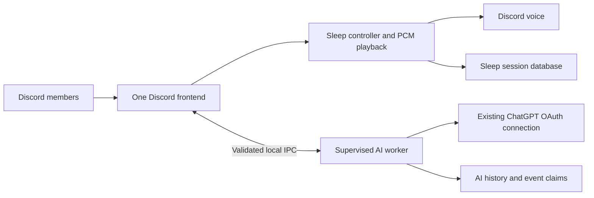

# Architecture and failure behavior

Back to the [README](../README.md).

`src/main.ts` owns all Discord events and sends each known slash command to one handler. `src/integration/sleep-handler.ts` acknowledges controls before fetching the member and enforces sleep permissions. The preserved `src/sleep/` modules implement per-guild serialized actions, reconnects, removal suspension, one voice channel per guild, rain scenes/thunder and sunny loops. Assets are local PCM; attribution is in [`assets/SOURCE.md`](../assets/SOURCE.md).

The worker receives bounded AI requests and selected context through advanced Node IPC serialization. Its environment excludes Discord credentials, API keys and inherited Node injection options. This is process isolation for responsiveness and accidental failure containment, **not an OS security sandbox**: both processes run as the same Windows user.

The frontend formats no AI images. Worker output contains the final Discord payload, including binary attachments. The frontend delivers it once and acknowledges delivery; the worker commits history only afterward. Repeated/late results cannot send a second callback. Durable SQLite event claims prevent regeneration on Discord event replay; mention sends additionally enforce a source-message nonce. Delivery is not a distributed transaction: a crash after Discord accepts a message can lose its history turn, but the event is not automatically replayed.

Worker crashes reject outstanding questions and trigger bounded backoff restarts without resetting voice/player objects. Only a lock owned by the exact exited worker is cleared automatically. Auth/foreign locks are never cleared. Failed/crashed questions must be sent again as a **new** Discord message/interaction. The frontend can continue sleep controls while AI is starting, unavailable or usage-limited. A frontend or host crash still interrupts voice until restart; the child does not make voice independently resilient to a host outage.

AI limits remain: one active generation, four active/queued conversations, five-second per-member cooldown, two-minute active request deadline, 4,000-character prompt, 12,000-character output, one image up to 14 MiB and bounded raster decoding. Local conversations expire after 24 hours and retain at most ten whole turns/24,000 characters. Image previews are capped at 8 MiB and respect the upload limit supplied for slash interactions. IPC adds bounded reference/delivery waits and a total queue/request watchdog.

